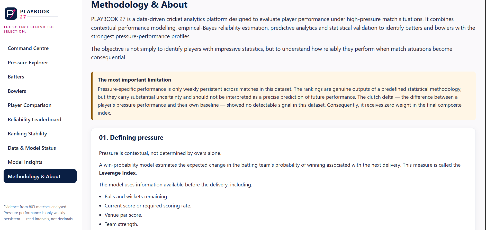
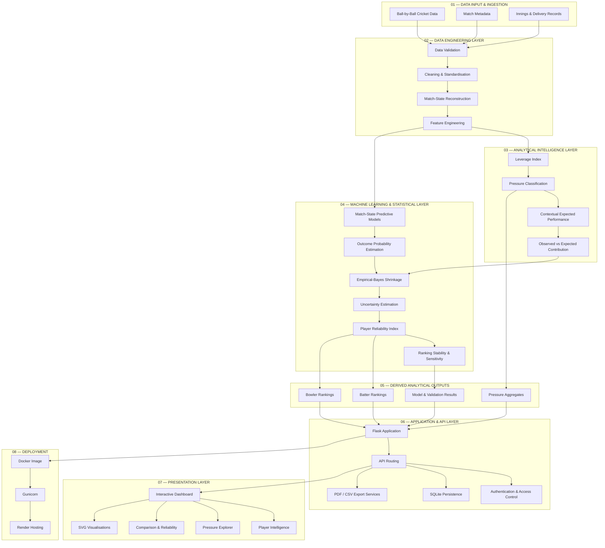
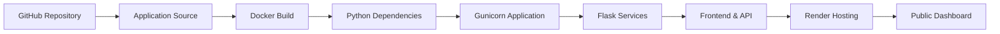

<div align="center">

# 🏏 PLAYBOOK 27
### THE SCIENCE BEHIND THE SELECTION

**Pressure-Performance Analytics · Machine Learning · Statistical Modelling · Explainable Player Evaluation**

*Who performs better than expected when the match gets difficult—and how confident can we be in that assessment?*

<br>

[](https://playbook-27.onrender.com/)
[](https://github.com/yogitha-singh/PLAYBOOK-27)
[](https://www.python.org/)
[](https://flask.palletsprojects.com/)
[](https://www.docker.com/)

<br>

**Built for Rajasthan Royals SupeRR Selector — Season 2, Round 1**

</div>

---

## 🔴 LIVE PROJECT

### Explore PLAYBOOK 27

**Live Dashboard:**  
### [https://playbook-27.onrender.com/](https://playbook-27.onrender.com/)

**Source Code:**  
[https://github.com/yogitha-singh/PLAYBOOK-27](https://github.com/yogitha-singh/PLAYBOOK-27)

> **⏳ Deployment Notice — Render Free Tier**
>
> This application is hosted using Render's free web-service tier. After approximately 15 minutes without incoming traffic, the service may spin down automatically. The first visit after inactivity can therefore take around a minute while the application starts again. If the page initially appears to be loading, please allow it some time and refresh if necessary.

---

# 01. Project Overview

## Beyond Conventional Cricket Statistics

Traditional cricket analysis often evaluates players using aggregate statistics such as batting average, strike rate, economy rate, wickets and runs scored.

However, these measurements do not fully represent the difficulty of the situation in which a performance occurs.

A batter scoring 35 runs during a comfortable chase and a batter scoring 35 runs while defending a collapsing innings have not necessarily delivered equivalent performances.

Similarly, a bowler taking two wickets during a low-pressure phase may have a different impact from a bowler taking two wickets during a critical phase of a close match.

**PLAYBOOK 27** addresses this analytical gap through a pressure-aware player evaluation framework.

It is an end-to-end cricket analytics and player intelligence platform that combines:

- Ball-by-ball data processing.
- Match-state and situational feature engineering.
- Leverage-based pressure identification.
- Context-adjusted performance evaluation.
- Machine-learning-based match outcome modelling.
- Empirical-Bayes statistical shrinkage.
- Player reliability estimation.
- Uncertainty quantification.
- Ranking stability and sensitivity analysis.
- Interactive player intelligence dashboards.

The platform is designed to identify players who perform above contextual expectations under difficult match conditions while explicitly communicating the uncertainty surrounding their rankings.

### The central research question

> Does a player consistently outperform contextual expectations under pressure, and is the available evidence sufficiently reliable to justify placing that player among the strongest candidates?

This changes the objective from simply identifying the players with the highest raw statistics to evaluating performance quality, context, consistency and statistical confidence together.

---

# 02. Competition Context & Objective

**Competition:** Rajasthan Royals SupeRR Selector  
**Season:** 2  
**Round:** 1

The project approaches player selection as a structured analytical problem.

The objective is to identify and evaluate:

- Top 10 batters under pressure.
- Top 10 bowlers under pressure.
- Players whose pressure performance exceeds contextual expectations.
- Players whose observed performance is supported by sufficient evidence.
- Players whose rankings remain reasonably stable under alternative assumptions.

The framework does not treat a leaderboard position as an absolute measure of player quality.

Instead, it combines performance estimates with uncertainty intervals, reliability measures and sensitivity analysis.

### Why this matters

A player may have an excellent observed pressure score but very few qualifying opportunities.

Another player may have a slightly lower observed score but a much larger and more consistent evidence base.

A useful scouting system must distinguish between these situations rather than treating the two players as equally reliable.

---

# 03. Key Features & Analytical Capabilities

| Module | Function |
|---|---|
| Command Centre | Overall analytical overview and leading insights |
| Batter Intelligence | Context-adjusted batting performance and player evaluation |
| Bowler Intelligence | Pressure-aware bowling performance and player evaluation |
| Pressure Explorer | Exploration of leverage, match states and pressure phases |
| Player Comparison | Comparative evaluation of selected players |
| Reliability Leaderboard | Ranking players using conservative reliability estimates |
| Ranking Stability | Sensitivity analysis and ranking uncertainty |
| Data & Model Status | Data and model information presented by the application |
| Model Insights | Predictive model performance and analytical findings |
| Methodology | Explanation of the statistical framework and evaluation process |

### Core capabilities

**Contextual performance evaluation**

Evaluates player contributions relative to the expected performance under comparable match conditions.

**Pressure identification**

Uses a model-based Leverage Index to identify high-impact match situations.

**Reliability-aware ranking**

Applies empirical-Bayes shrinkage to reduce the influence of noisy estimates, particularly when observations are limited.

**Uncertainty-aware scouting**

Communicates the uncertainty around player estimates instead of presenting rankings as unquestionable facts.

**Interactive exploration**

Allows users to examine individual player profiles, compare players and explore pressure-specific performance.

**Reproducible analytical outputs**

Uses processed analytical outputs and model artefacts to support consistent dashboard reporting.

---

# 04. Dashboard Preview

The application is organised into ten analytical modules.

All screenshots are maintained in the independent root-level `screenshots/` directory of the repository.

They are not stored inside `docs/`.

### 01 — Command Centre

The primary analytical overview, bringing together the platform's key findings and player intelligence.


### 02 — Batter Intelligence

Examines pressure-specific batting performance, contextual contribution and player-level evaluation.


### 03 — Bowler Intelligence

Evaluates bowling contributions in high-leverage situations and provides a comparative view of player performance.


### 04 — Pressure Explorer

Explores pressure distributions, leverage-based match situations and performance across different phases.


### 05 — Player Comparison

Provides a structured comparison of selected players using analytical performance indicators.


### 06 — Reliability Leaderboard

Highlights player evaluations using conservative estimates that account for uncertainty.


### 07 — Ranking Stability

Examines how sensitive player rankings are to changes in modelling assumptions and evaluation parameters.


### 08 — Data & Model Status

Presents the application's data and model status information.


### 09 — Model Insights

Summarises predictive modelling results and analytical observations.


### 10 — Methodology

Explains the underlying analytical approach and the reasoning behind the evaluation framework.



---

# 05. Analytical Methodology

The analytical framework is built around one principle:

**Performance should be evaluated relative to the difficulty of the situation in which it occurs.**

The pipeline combines match-state modelling, pressure identification, contextual expectation, statistical adjustment and uncertainty analysis.

## 5.1 Data Preparation & Processing

The analytical workflow begins with ball-by-ball cricket data.

The data preparation process involves:

1. Loading and inspecting the source data.
2. Standardising match, innings and delivery-level information.
3. Handling missing and inconsistent observations.
4. Identifying relevant match and innings states.
5. Engineering contextual performance features.
6. Preparing structured analytical datasets.
7. Generating processed outputs for downstream modelling.

The pipeline produces derived datasets and analytical aggregates used by the modelling and dashboard layers.

Raw competition data is kept separate from the derived outputs used by the application.

## 5.2 Match-State Modelling

A delivery cannot be evaluated independently of the match situation.

Relevant contextual variables include:

- Innings and innings phase.
- Current score and wickets lost.
- Overs completed and remaining.
- Runs required and balls remaining.
- Required run rate.
- Match situation and leverage.
- Batter and bowler contributions.

These features help represent the state of a match at a particular point in time.

## 5.3 Leverage Index & Pressure Identification

A central component of PLAYBOOK 27 is its model-based Leverage Index.

Leverage represents the potential impact of a particular match situation on the eventual outcome.

A delivery that can substantially change the probability of winning is more consequential than a delivery in which the match outcome is relatively unaffected.

The framework uses leverage percentiles to classify pressure:

| Situation | Leverage Percentile |
|---|---:|
| Standard | Below 80th percentile |
| High Pressure | 80th–95th percentile |
| Critical Pressure | Top 5% |

**Pressure deliveries are defined as the combined High and Critical categories.**

This corresponds to the top 20% of the model-based Leverage Index within an innings.

This approach makes pressure identification relative to the distribution of match situations rather than relying on arbitrary over numbers or subjective labels.

## 5.4 Context-Adjusted Performance

Raw performance is not sufficient to determine whether a player exceeded expectations.

The framework compares observed contributions against contextual expectations.

Conceptually:

`Contextual Performance = Observed Performance − Expected Performance`

The expected performance represents a reference level for a comparable situation.

This makes it possible to distinguish between:

- High output in a relatively comfortable situation.
- High output in a difficult situation.
- Low output despite favourable conditions.
- Performance that exceeds expectations under pressure.

The objective is to isolate the value of a player's contribution beyond what the match context would ordinarily suggest.

## 5.5 Empirical-Bayes Shrinkage

Pressure-specific observations are often limited.

A player may have only a small number of high-leverage opportunities, which can make an observed average unstable.

To reduce this problem, PLAYBOOK 27 uses empirical-Bayes shrinkage.

The observed estimate is adjusted towards a broader reference estimate, with the degree of adjustment influenced by the available evidence.

In simplified form:

`Posterior Estimate = Weighted Combination of Observed Estimate and Prior Estimate`

The purpose is to prevent a small number of unusually successful or unsuccessful observations from dominating player evaluation.

Players with limited evidence receive more conservative estimates, while players with stronger evidence retain more influence from their observed performance.

## 5.6 Player Reliability Index (PRI)

The Player Reliability Index is designed to provide a conservative estimate of pressure-performance reliability.

The framework uses a lower-confidence-bound approach:

`PRI = μ_posterior − 1.28 × σ_posterior`

Where:

- `μ_posterior` represents the posterior mean estimate.
- `σ_posterior` represents posterior uncertainty.
- `1.28` corresponds approximately to a one-sided 90% normal-theory lower bound.

A higher PRI indicates a stronger conservative estimate of performance after accounting for uncertainty.

This is particularly useful when comparing players with different numbers of pressure opportunities.

**Important:** PRI is an uncertainty-aware evaluation measure, not a guarantee of future performance.

## 5.7 Ranking Stability & Sensitivity Analysis

A single ranking can hide important weaknesses in the underlying evidence.

PLAYBOOK 27 therefore examines whether rankings remain stable when analytical assumptions change.

The sensitivity framework evaluates:

- Changes in player ordering.
- Variations in ranking positions.
- Alternative evaluation assumptions.
- Overlap between ranking uncertainty intervals.
- The probability of a player belonging to the top 10.
- Differences between observed performance and reliable performance.

This helps identify players whose rankings are robust and players whose positions depend heavily on modelling assumptions.

---

# 06. Machine Learning & Predictive Modelling

Machine learning is used to represent match-state dynamics and generate contextual predictions.

The project includes predictive modelling for match outcomes and innings-level scenarios.

### Model families

- Gradient Boosting-based predictive models.
- Classification models for outcome estimation.
- Regression models for innings outcome estimation.
- Probability-based match-state evaluation.

### Chronological evaluation

The modelling workflow uses a chronological holdout structure:

| Dataset Role | Season |
|---|---|
| Training | Before 2025 |
| Validation | 2025 |
| Testing | 2026 |

Chronological separation is important because cricket data is time-dependent.

Randomly mixing observations across seasons can introduce information leakage and produce overly optimistic validation results.

### Reported model evaluation

The following are reported analytical results from the project evaluation:

| Model | Metric | Result |
|---|---|---:|
| Chase Win-Probability Model | ROC-AUC | 0.918 |
| Chase Win-Probability Model | Brier Score | 0.123 |
| Chase Win-Probability Model | Log Loss | 0.378 |
| First-Innings Model | ROC-AUC | 0.684 |
| First-Innings Model | Log Loss | 0.671 |
| Nine-Class Outcome Model | MAE | 1.381 |
| Nine-Class Outcome Model | Baseline MAE | 1.438 |
| Nine-Class Outcome Model | R² | 0.017 |
| Wicket Prediction | ROC-AUC | 0.587 |

### Interpreting these results

The chase model demonstrates useful discrimination in the evaluated holdout data.

The first-innings and nine-class models have more limited predictive strength.

The nine-class model improves on the stated flat baseline in MAE, but its low R² indicates that substantial outcome variation remains unexplained.

These models are components of a larger analytical framework. Their results should not be interpreted as proof that every individual player ranking is predictive.

---

# 07. Statistical Validation & Reliability Findings

A major objective of this project is to understand not only which players rank highly, but also how much confidence should be placed in those rankings.

### Out-of-sample reliability

The reported out-of-sample relationship between pressure-performance estimates and holdout performance is:

| Player Category | Rank Correlation |
|---|---:|
| Batters | -0.02 |
| Bowlers | 0.32 |

These results indicate that pressure-specific performance is not strongly persistent for batters in the evaluated sample, while bowlers show a more positive relationship.

### Effect of shrinkage

Empirical-Bayes shrinkage reduced holdout estimation error by:

| Player Category | Reported Error Reduction |
|---|---:|
| Batters | 36% |
| Bowlers | 40% |

This supports the use of statistical regularisation when evaluating players with limited pressure observations.

### Split-half persistence

Reported split-half persistence:

| Player Category | Correlation |
|---|---:|
| Batters | Approximately 0.29 |
| Bowlers | Approximately 0.24 |

These relatively modest values reinforce the need for conservative interpretation.

### Ranking uncertainty

Sensitivity analysis indicates:

- Bowler rankings retain approximately 4–10 players across the evaluated top-10 sensitivity range.
- Batter rankings retain approximately 2–8 players.
- Uncertainty intervals overlap between the top 10 and the next ranking position.
- Median estimated probability of truly belonging to the top 10 is approximately 46% for batters and 32% for bowlers.

### What these findings mean

The project does not claim that pressure performance is a perfectly stable player characteristic.

Instead, the evidence suggests that pressure-specific rankings contain meaningful uncertainty.

That uncertainty is part of the analytical result—not something to hide.

The platform is designed to communicate this distinction through conservative estimates, confidence intervals, reliability measures and sensitivity analysis.

---

# 08. System Architecture

PLAYBOOK 27 follows a modular, layered architecture that separates data processing, analytical computation, model artefacts, application services and user-facing visualisation.

It is a single deployable application with distinct logical components—not a collection of independently deployed microservices.

## High-Level Architecture



## Architectural Layers

| Layer | Responsibility |
|---|---|
| Data Ingestion | Receives and organises source cricket data |
| Data Engineering | Validates, cleans and transforms delivery-level records |
| Feature Engineering | Constructs match-state and contextual variables |
| Pressure Intelligence | Computes leverage and classifies pressure situations |
| Predictive Modelling | Estimates match and innings outcome probabilities |
| Statistical Intelligence | Applies shrinkage and uncertainty-aware estimation |
| Ranking Engine | Produces conservative player evaluations and stability outputs |
| Persistence Layer | Uses SQLite for application data |
| Backend Services | Exposes application functionality through Flask API routes |
| Presentation Layer | Provides the interactive JavaScript dashboard |
| Deployment Layer | Packages and serves the application using Docker and Gunicorn |

### Design considerations

**Separation of concerns**

Data preparation, modelling, application services and visualisation are maintained as separate logical responsibilities.

**Derived-data delivery**

Processed analytical outputs and model artefacts are separated from confidential raw source data.

**Application security**

The deployment configuration uses environment-based API key and CORS settings. The Docker container runs under a non-root application user.

**Persistent local database storage**

The Docker Compose configuration defines a named volume for the SQLite database.

**Health monitoring**

The Docker image includes a health check against the application's `/api/v1/health` endpoint.

---

# 09. Technology Stack

The project combines data engineering, statistical computing, backend development, frontend visualisation and containerised deployment.

### 🐍 Programming & Data Processing

| Technology | Role |
|---|---|
| Python 3.12 | Core analytical and backend language |
| Pandas | Data manipulation and processing |
| NumPy | Numerical computation |
| Scikit-learn | Predictive modelling and evaluation |

### 🤖 Machine Learning & Statistics

| Technology | Role |
|---|---|
| Gradient Boosting | Predictive modelling |
| Classification | Match outcome estimation |
| Regression | Numerical outcome estimation |
| Empirical-Bayes Methods | Statistical shrinkage |
| Probability Calibration Metrics | Evaluation of predicted probabilities |
| Sensitivity Analysis | Ranking robustness |
| Uncertainty Estimation | Conservative player evaluation |

### ⚙️ Backend & Application Services

| Technology | Role |
|---|---|
| Flask | Backend application framework |
| SQLite | Relational data persistence |
| Gunicorn | Python application server |
| REST-style API | Application communication |
| API Key Configuration | Access control |
| CSV / PDF | Analytical exports |

### 🎨 Frontend & Visualisation

| Technology | Role |
|---|---|
| HTML5 | Application structure |
| CSS3 | Styling and design system |
| JavaScript | Dashboard interactions |
| SVG | Data visualisation and charts |

### 🐳 Infrastructure & Deployment

| Technology | Role |
|---|---|
| Docker | Application containerisation |
| Docker Compose | Local container orchestration |
| Render | Cloud hosting |
| Git | Version control |
| GitHub | Source-code management |

---

# 10. Repository Structure

The repository separates the backend, frontend, analytical outputs, models, scripts and visual documentation.

```text
PLAYBOOK-27/
│
├── .github/
│   └── workflows/
│
├── backend/
│   ├── Dockerfile
│   ├── requirements.txt
│   └── ...
│
├── data/
│   └── processed/
│       ├── ...
│       └── ...
│
├── frontend/
│   ├── index.html
│   ├── css/
│   ├── js/
│   └── ...
│
├── models/
│   └── ...
│
├── scripts/
│   └── ...
│
├── screenshots/
│   ├── Command Centre.png
│   ├── Batter Intelligence.png
│   ├── Bowler Intelligence.png
│   ├── Pressure Explorer.png
│   ├── Player Comparison.png
│   ├── Reliability Leaderboard.png
│   ├── Ranking Stability.png
│   ├── Data and Model Status.png
│   ├── Model Insights.png
│   └── Methodology.png
│
├── docker-compose.yml
├── .gitignore
├── README.md
└── __init__.py
```

*The `...` entries represent files within the corresponding project directories.*

### Directory responsibilities

- **`backend/`** — Flask application, API services, database integration and backend dependencies.
- **`frontend/`** — Interactive dashboard, application pages, JavaScript functionality, CSS and SVG visualisations.
- **`data/processed/`** — Derived datasets, processed rankings and analytical aggregates.
- **`models/`** — Trained model artefacts.
- **`scripts/`** — Data processing, modelling and analytical pipeline scripts.
- **`screenshots/`** — Independent dashboard screenshots used for project documentation.
- **`docker-compose.yml`** — Container configuration for running the application.
- **`backend/Dockerfile`** — Application image configuration.

---

# 11. Backend & API Architecture

The backend is implemented using Flask and exposes the application's analytical and operational functionality through API routes.

The repository's application implementation includes 25 API routes.

### Backend responsibilities

- Application initialisation.
- API request handling.
- Authentication and access control.
- Database interaction.
- Delivery of analytical outputs.
- Player and ranking information.
- Data export functionality.
- Application health monitoring.

### Database

SQLite is used for application-level persistence.

The Docker Compose configuration mounts a named volume at the database storage location:

`/app/data/app.sqlite3`

This keeps the local container database separate from the application source code.

### API health endpoint

The configured health endpoint is:

`/api/v1/health`

It is also used by the Docker health-check configuration.

### Export functionality

The application includes PDF and CSV export capabilities for analytical information.

---

# 12. Deployment Architecture

PLAYBOOK 27 uses Docker-based application packaging and is deployed through Render.

### Deployment flow



### Docker configuration

The application Dockerfile uses:

- Python 3.12 slim base image.
- Backend dependency installation.
- Backend and frontend source inclusion.
- Processed analytical data inclusion.
- Model artefact inclusion.
- Non-root application execution.
- Port 8000.
- Gunicorn with two workers.
- An HTTP health check.

The Docker image copies derived processed data and model artefacts rather than the confidential raw competition data pack.

### Running locally with Docker

**Prerequisites**

- Git
- Docker Desktop
- Docker Compose

Clone the repository:

```bash
git clone https://github.com/yogitha-singh/PLAYBOOK-27.git

cd PLAYBOOK-27
```

Create a `.env` file in the repository root:

```env
PLAYBOOK_ENV=production
PLAYBOOK_API_KEY=replace_with_a_secure_secret
PLAYBOOK_CORS_ORIGINS=
```

Provide a secure API key before starting the application.

Build and start the application:

```bash
docker compose up --build
```

The Compose configuration maps port `8000` from the container to port `8000` on the host.

Open:

```text
http://localhost:8000
```

Health endpoint:

```text
http://localhost:8000/api/v1/health
```

Stop the application:

```bash
docker compose down
```

The named Docker volume is retained when containers are stopped. Removing volumes explicitly will remove the associated local database data.

---

# 13. Data Integrity, Security & Responsible Analytics

A scouting platform should not sacrifice analytical integrity for an impressive leaderboard.

PLAYBOOK 27 follows several important principles.

### Raw-data separation

Confidential raw competition data is not copied into the application Docker image. The application image uses derived processed outputs.

### Environment-based configuration

Sensitive configuration values such as the API key are supplied through environment variables rather than hard-coded deployment configuration.

### Non-root container execution

The Docker image creates and uses a dedicated application user instead of running the application as root.

### Statistical transparency

The system communicates that rankings are estimates affected by sample size, model assumptions and uncertainty.

### No false certainty

A high ranking does not automatically mean that a player is definitively superior to every player below them.

### Limitations are part of the result

Pressure-specific performance can be weakly persistent across matches. This is why ranking stability, uncertainty and reliability are central components of the platform.

---

# 14. Limitations & Interpretation

The project is designed to support analytical decision-making, not to replace human scouting judgement.

Several limitations should be considered.

**1. Limited pressure-specific observations**

Some players have relatively few qualifying pressure opportunities.

**2. Weak persistence**

Pressure-specific performance is not consistently persistent across all player categories.

**3. Model dependence**

Leverage estimates and contextual expectations depend on the assumptions and predictive quality of the underlying models.

**4. Ranking uncertainty**

Players with overlapping uncertainty intervals may not be meaningfully distinguishable despite having different displayed ranks.

**5. Historical-data limitations**

Historical performance cannot guarantee future performance under different teams, conditions, roles or opposition.

**6. Interpretation of predictive metrics**

A model's predictive performance does not automatically validate every player-level ranking generated by the larger evaluation framework.

For these reasons, PLAYBOOK 27 emphasises evidence strength, conservative estimates and sensitivity analysis alongside player rankings.

---

# 15. Future Scope

Potential extensions include:

- Incorporating additional seasons and competition formats.
- Expanding player-role-specific contextual modelling.
- Improving uncertainty estimation through alternative statistical methods.
- Adding further out-of-sample validation.
- Investigating hierarchical player and team effects.
- Introducing richer player similarity and comparison analysis.
- Exploring explainability methods for predictive models.
- Improving automated data-quality and model-monitoring workflows.
- Extending the platform to support broader scouting and recruitment decisions.

---

# 16. Why PLAYBOOK 27?

Most statistical leaderboards answer:

**Who has the highest numbers?**

PLAYBOOK 27 asks a more demanding set of questions:

- What was the match situation?
- How much leverage did the player have?
- What would an average player have been expected to contribute?
- Did the player outperform that expectation?
- How many relevant opportunities support the estimate?
- How much uncertainty surrounds the result?
- Does the ranking survive changes in analytical assumptions?

The distinction is important.

A useful scouting framework should not simply reward the largest observed number. It should help decision-makers understand the quality, context and reliability of the evidence behind it.

That is the analytical foundation of PLAYBOOK 27.

---

# 17. Project Links

| Resource | Link |
|---|---|
| Live Dashboard | [Open PLAYBOOK 27](https://playbook-27.onrender.com/) |
| GitHub Repository | [View Source Code](https://github.com/yogitha-singh/PLAYBOOK-27) |
| Deployment Platform | [Render](https://render.com/) |

---

<div align="center">

### PLAYBOOK 27
**THE SCIENCE BEHIND THE SELECTION.**

*Context over raw numbers. Evidence over assumptions. Reliability over appearances.*

<br>

Built for the Rajasthan Royals SupeRR Selector — Season 2, Round 1.

</div>
