\<div align="center">

# PLAYBOOK 27

### THE SCIENCE BEHIND THE SELECTION

**Pressure-Aware Cricket Analytics & Player Intelligence**

An analytical platform combining machine learning, statistical modelling, contextual performance evaluation and uncertainty-aware player rankings.

\<br>

\


\<br>

`CRICKET ANALYTICS` · `MACHINE LEARNING` · `PREDICTIVE MODELLING` · `PLAYER SCOUTING`

### NOT JUST WHO SCORES MORE.

### WHO PERFORMS WHEN IT MATTERS.

\</div>

---

## 01 — Project Overview

Cricket performance is traditionally evaluated through statistics such as runs, wickets, averages and strike rates.

However, these metrics do not always capture the circumstances in which a performance occurs.

A run scored in a comfortable situation is not necessarily equivalent to a run scored during a difficult chase. Similarly, a wicket taken during a critical phase can carry greater strategic significance than one taken when the outcome is already decided.

**PLAYBOOK 27** explores this problem through pressure-aware cricket analytics.

Developed for **Rajasthan Royals SupeRR Selector — Season 2, Round 1**, the platform evaluates batter and bowler performances under pressure using match-state modelling, contextual expectations, statistical reliability and uncertainty-aware ranking methods.

The objective is to investigate:

- How does a player perform when match pressure increases?
- Does their performance exceed expectations in comparable situations?
- How reliable is the observed performance?
- Do rankings remain stable under different analytical assumptions?
- How much confidence should be placed in a player's ranking?

The result is an interactive scouting platform designed to turn match data into explainable player intelligence.

---

## 02 — Explore the Dashboard

\<div align="center">

### [↗ OPEN PLAYBOOK 27 — LIVE DASHBOARD](https://playbook-27.onrender.com/)

Explore all ten analytical modules through the deployed application.

\</div>

| Module                          | Description                                            |
| ------------------------------- | ------------------------------------------------------ |
| **01. Command Centre**          | Platform overview and key analytical findings.         |
| **02. Batter Intelligence**     | Contextual batter performance and pressure evaluation. |
| **03. Bowler Intelligence**     | Bowler performance across pressure situations.         |
| **04. Pressure Explorer**       | Match pressure distribution and phase analysis.        |
| **05. Player Comparison**       | Comparative player performance evaluation.             |
| **06. Reliability Leaderboard** | Reliability-adjusted player rankings.                  |
| **07. Ranking Stability**       | Sensitivity and consistency of player rankings.        |
| **08. Data & Model Status**     | Dataset and model information.                         |
| **09. Model Insights**          | Predictive model performance and findings.             |
| **10. Methodology**             | Analytical framework and limitations.                  |

> **Deployment:** Hosted on Render's free tier. The first request after inactivity may take a little longer while the service wakes up.

---

## 03 — Main Dashboard Preview

The primary dashboard consists of ten interactive analytical views.

### 01. Command Centre

\<div align="center"> \ \</div>

### 02. Batter Intelligence

\<div align="center"> \ \</div>

### 03. Bowler Intelligence

\<div align="center">
\
\</div>

### 04. Pressure Explorer

\<div align="center">
\
\</div>

### 05. Player Comparison

\<div align="center"> \ \</div>

### 06. Reliability Leaderboard

\<div align="center">
\
\</div>

### 07. Ranking Stability

\<div align="center">
\
\</div>

### 08. Data & Model Status

\<div align="center">
\
\</div>

### 09. Model Insights

\<div align="center">
\
\</div>

### 10. Methodology

\<div align="center">
\
\</div>

---

## 04 — Responsive Dashboard Gallery

The project also includes a separate collection of desktop, mobile and tablet screenshots documenting the interface across different screen sizes.

These screenshots are maintained independently inside `docs/screenshots/`.

### Desktop Experience

\<div align="center">

**Overview**

\

**Batters**

\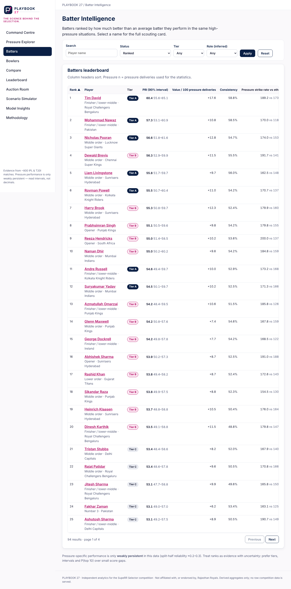

**Bowlers**

\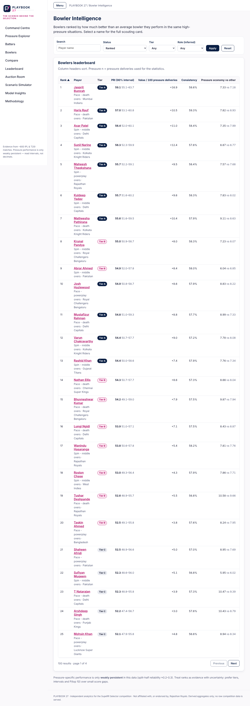

**Pressure Analysis**

\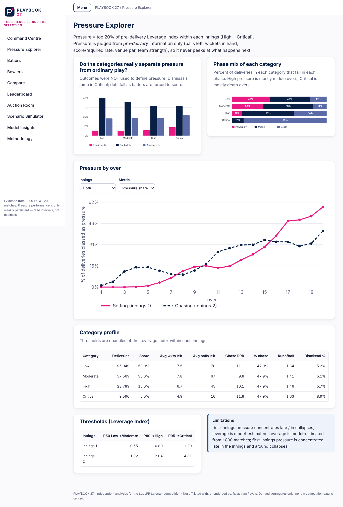

**Player Comparison**

\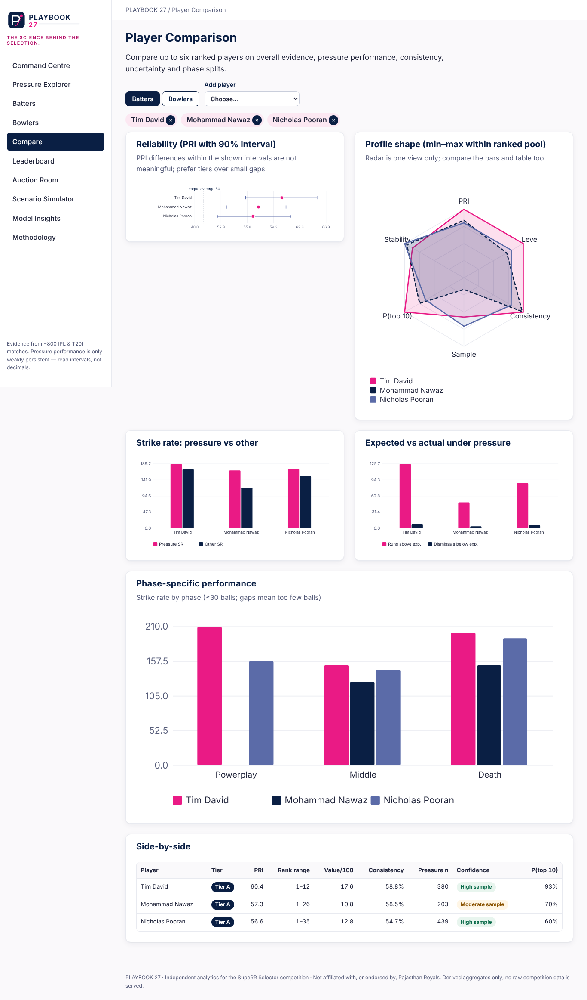

**Leaderboard**

\

**Models**

\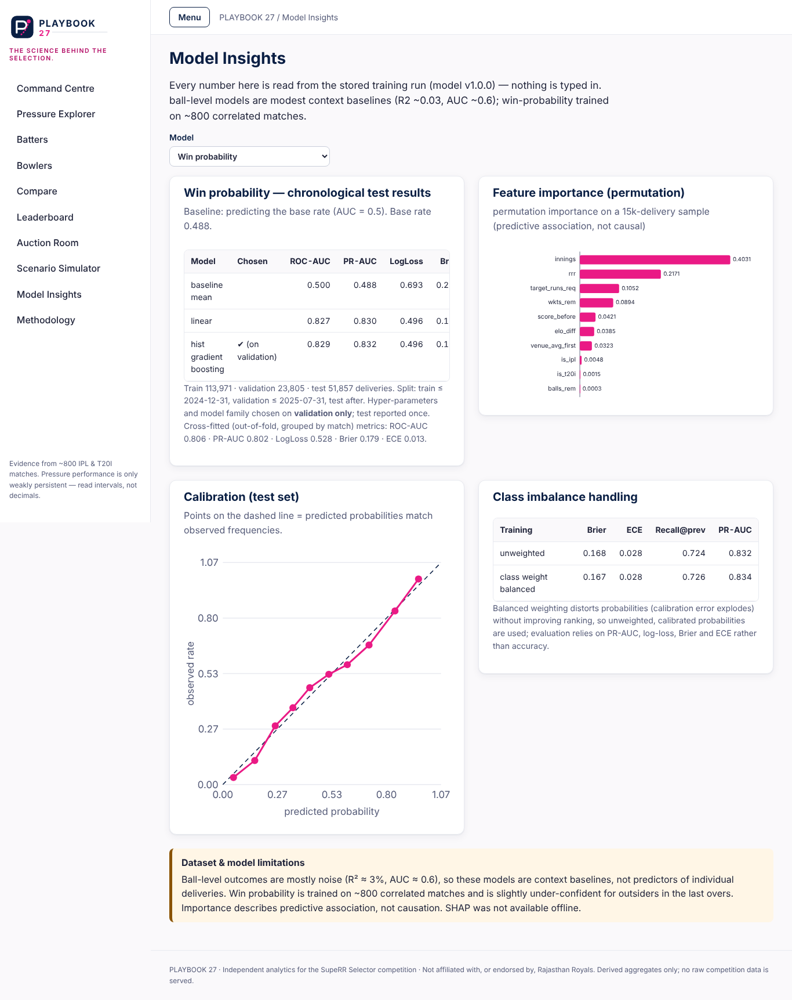

**Auction**

\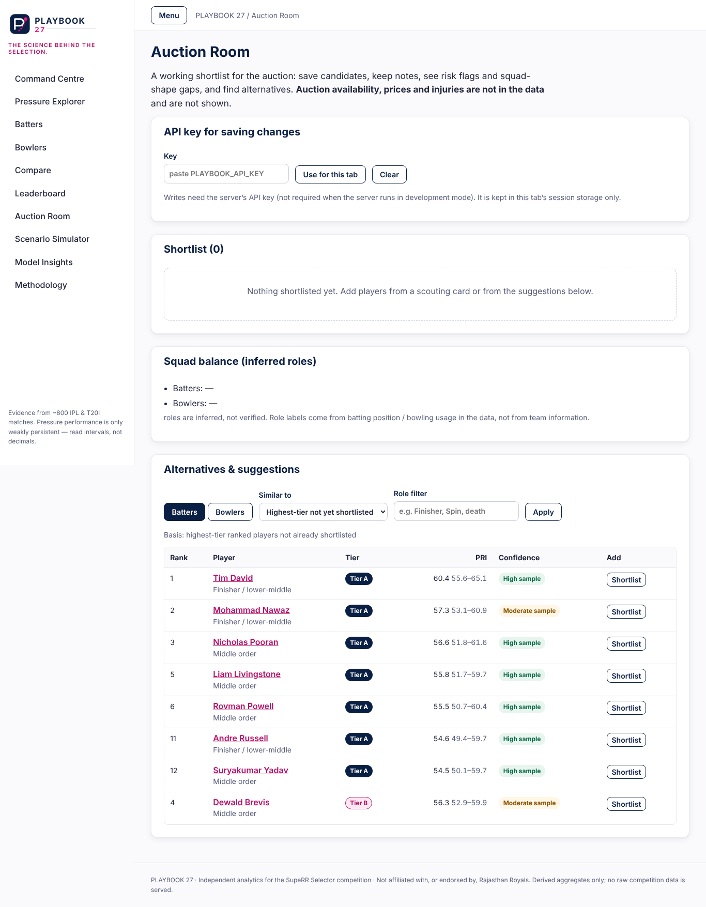

**Scenario Analysis**

\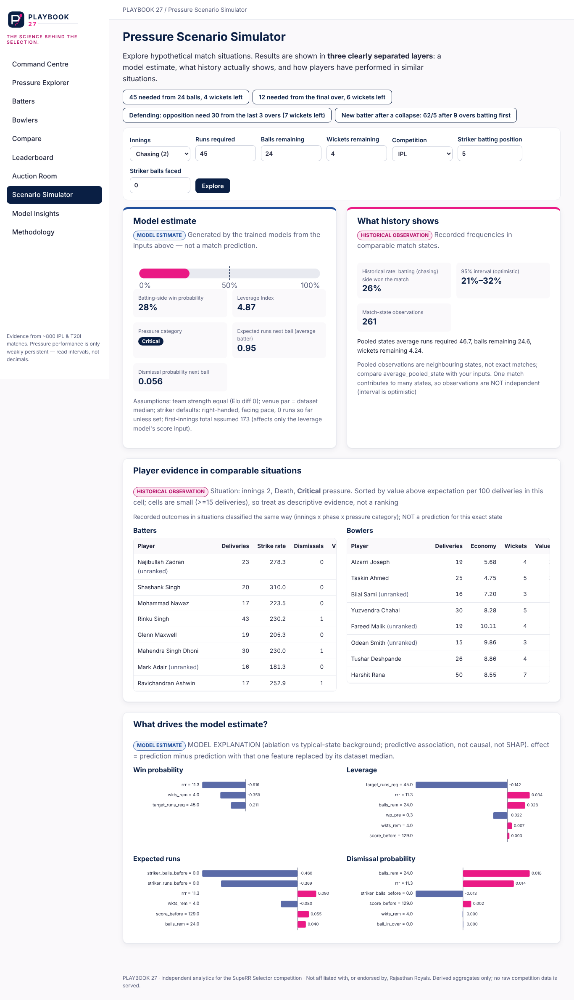

**About**

\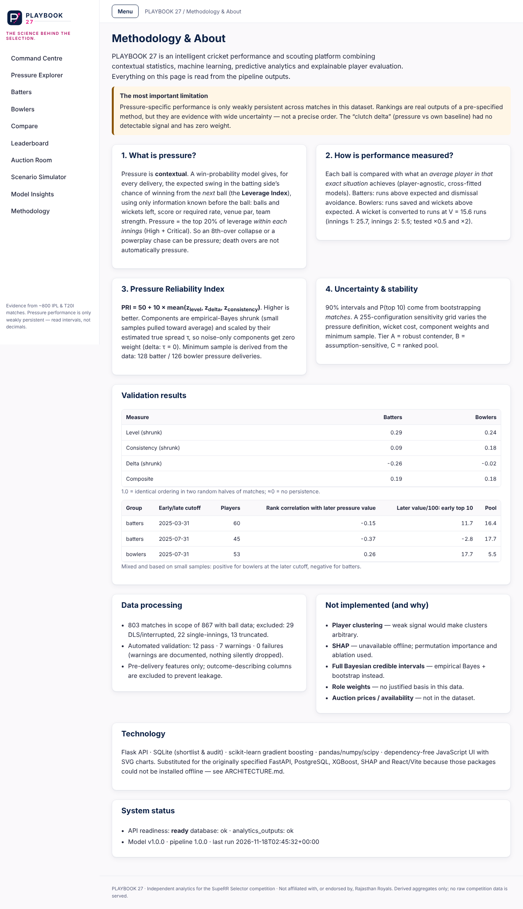

**Batter Scouting Card**

\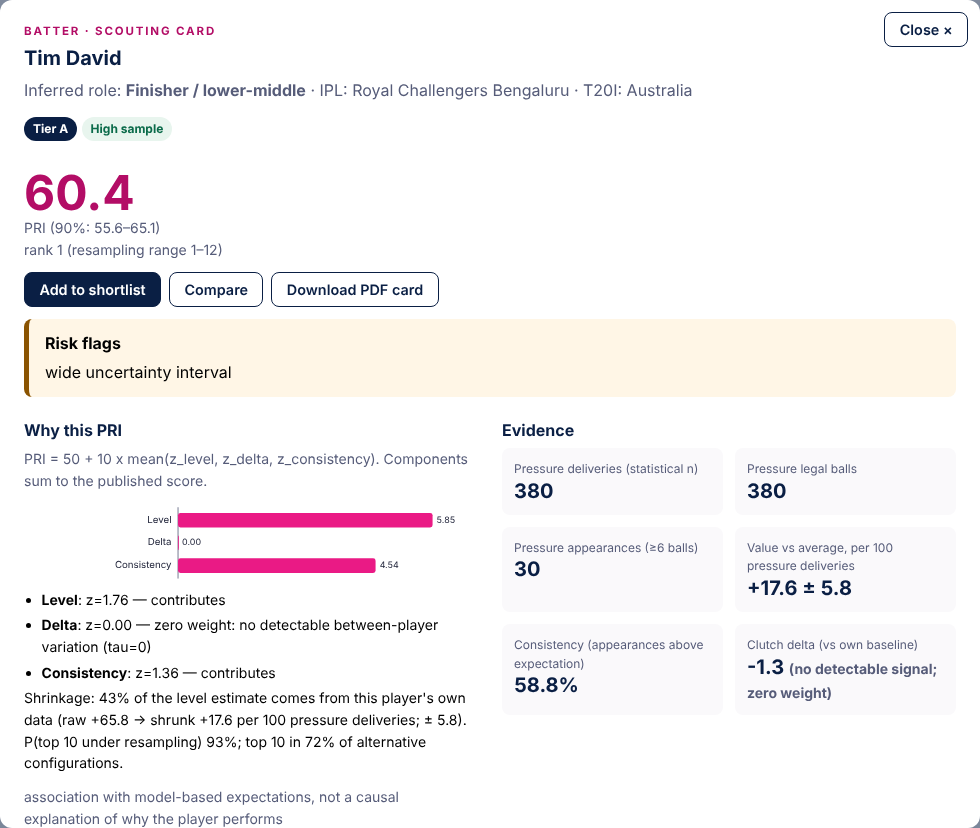

\</div>

### Mobile Experience

\<div align="center">

**Mobile Overview**

\

**Mobile Overview — Viewport**

\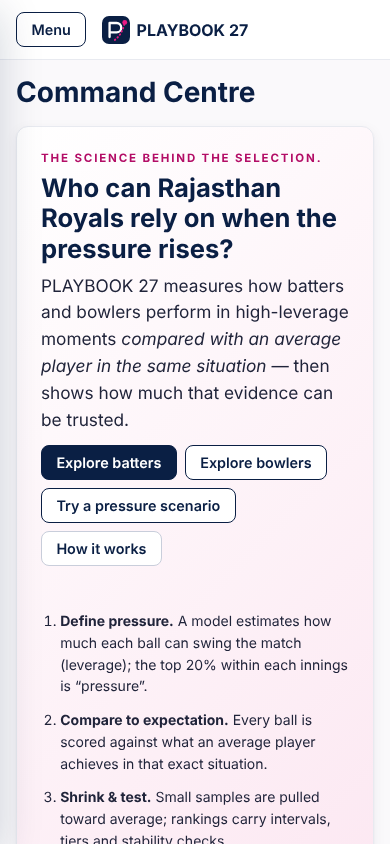

**Mobile Navigation**

\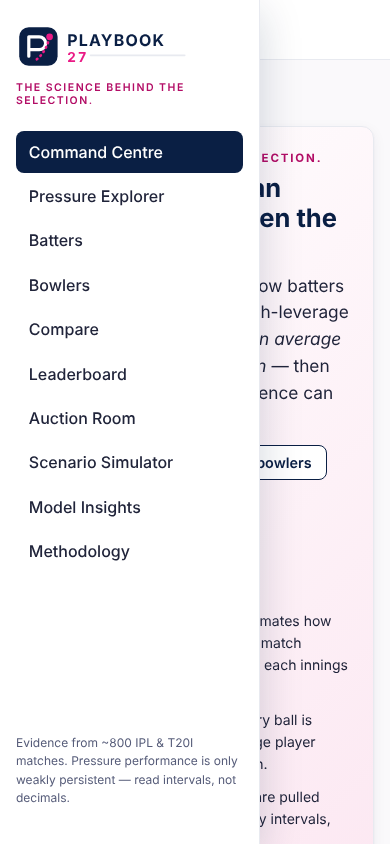

**Batters**

\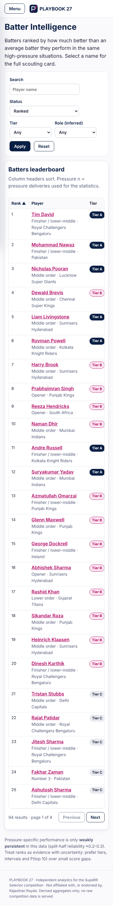

**Bowlers**

\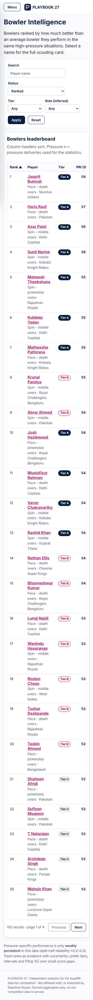

**Pressure Analysis**

\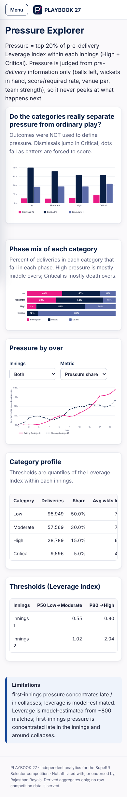

**Player Comparison**

\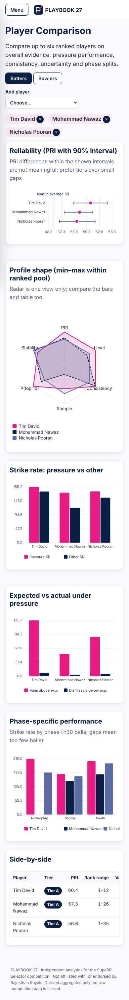

**Leaderboard**

\

**Models**

\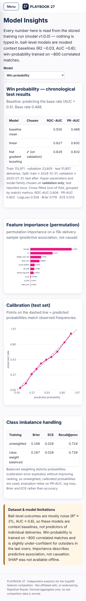

**Auction**

\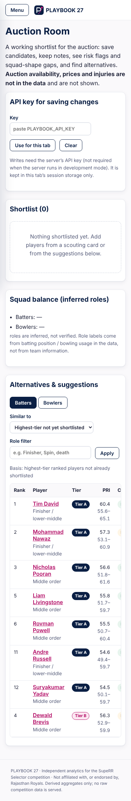

**Scenario Analysis**

\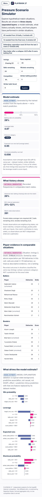

**About**

\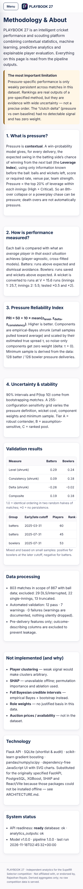

**Batter Scouting Card**

\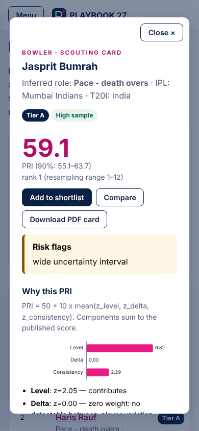

\</div>

### Tablet Experience

\<div align="center">

**Tablet Overview**

\

**Tablet Batters**

\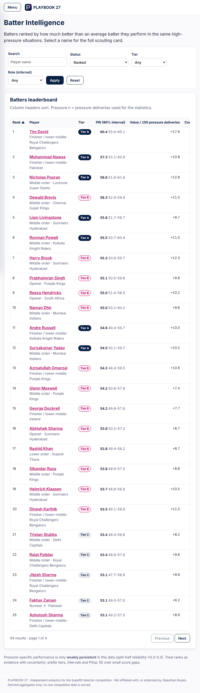

**Tablet Comparison**

\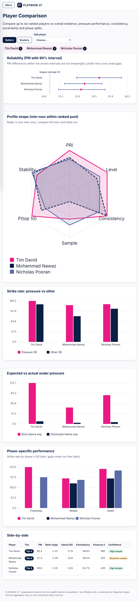

**Tablet Scenario Analysis**

\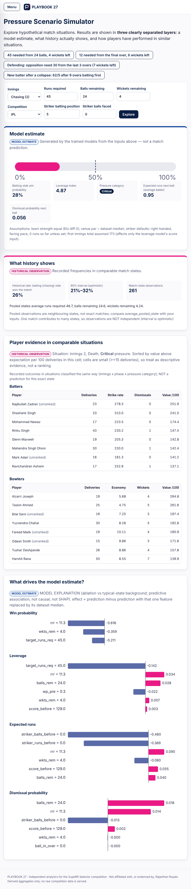

\</div>

---

## 05 — Analytical Framework

PLAYBOOK 27 follows a multi-stage analytical workflow.

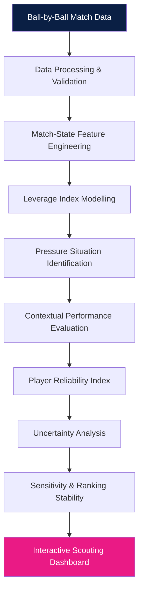

### Stage 1 — Data Processing

Match-level and delivery-level information is processed into structured analytical inputs.

The pipeline prepares the data for feature engineering, model training, pressure identification and player evaluation.

### Stage 2 — Match-State Modelling

Match situations are represented through contextual variables, including:

- Innings and match phase
- Score and wickets
- Overs and deliveries remaining
- Required run rate
- Chase situation
- Other relevant match-state features

### Stage 3 — Pressure Identification

Pressure is identified using a model-based **Leverage Index**.

The framework classifies situations using leverage percentiles within innings:

| Category            | Leverage Percentile  |
| ------------------- | -------------------- |
| High Pressure       | 80th–95th percentile |
| Critical Pressure   | Top 5%               |
| Pressure Deliveries | High + Critical      |

### Stage 4 — Contextual Performance Evaluation

Player contributions are evaluated relative to the expected performance of an average player in a comparable situation.

This helps distinguish raw statistical output from performance above contextual expectations.

### Stage 5 — Reliability Adjustment

Empirical-Bayes shrinkage is incorporated to account for sample-size differences and reduce the influence of extreme estimates supported by limited observations.

### Stage 6 — Uncertainty and Stability

The platform evaluates player assessments through:

- Posterior uncertainty intervals
- Split-half persistence
- Sensitivity analysis
- Ranking overlap
- Top-10 probability analysis

---

## 06 — Player Reliability Index (PRI)

The **Player Reliability Index** supports cautious, uncertainty-aware player evaluation.

Rather than relying exclusively on observed performance, PRI incorporates empirical-Bayes shrinkage and posterior uncertainty.

The reported conservative lower-bound formulation is:

[
PRI = \mu\_{posterior} - 1.28 \times \sigma\_{posterior}
]

Where:

- (\mu\_{posterior}) represents the posterior mean.
- (\sigma\_{posterior}) represents the posterior standard deviation.

The resulting score penalises estimates with greater uncertainty.

The purpose is to distinguish strong observed performance from performance supported by more reliable evidence.

---

## 07 — Model Validation

The modelling framework uses chronological validation to assess performance on later match periods.

| Period      | Purpose    |
| ----------- | ---------- |
| Before 2025 | Training   |
| 2025        | Validation |
| 2026        | Testing    |

### Predictive Model Results

| Model                 | Evaluation Metric | Result |
| --------------------- | ----------------- | -----: |
| Chase Win Probability | ROC-AUC           |  0.918 |
| Chase Win Probability | Brier Score       |  0.123 |
| Chase Win Probability | Log Loss          |  0.378 |
| First-Innings Model   | ROC-AUC           |  0.684 |
| First-Innings Model   | Log Loss          |  0.671 |
| 9-Class Outcome Model | MAE               |  1.381 |
| Flat Baseline         | MAE               |  1.438 |
| Wicket Prediction     | ROC-AUC           |  0.587 |

Predictive model performance and player-ranking reliability are separate considerations.

A model that predicts match outcomes effectively does not automatically establish that pressure-specific player rankings are stable.

---

## 08 — Reliability Is Not the Same as Rank

An important finding of the analysis is that pressure-specific performance has limited persistence across different samples of matches.

Reported split-half persistence:

| Player Category | Persistence |
| --------------- | ----------: |
| Batters         |        0.29 |
| Bowlers         |        0.24 |

The rankings should therefore be interpreted as evidence with uncertainty, rather than definitive measurements of player ability.

The analysis additionally investigates:

- Ranking stability under alternative assumptions.
- Overlap between player uncertainty intervals.
- Probability of genuinely belonging to the top ten.
- Sensitivity to evaluation choices.
- The impact of sample size on player reliability.

**A higher ranking does not automatically establish that one player is statistically superior to another.**

---

## 09 — Technology Stack

| Layer                | Technologies            |
| -------------------- | ----------------------- |
| Programming Language | Python                  |
| Data Processing      | Pandas, NumPy           |
| Machine Learning     | Scikit-learn            |
| Backend              | Flask                   |
| Database             | SQLite                  |
| Frontend             | HTML5, CSS3, JavaScript |
| Visualisation        | SVG Charts              |
| Containerisation     | Docker, Docker Compose  |
| Version Control      | Git, GitHub             |
| Deployment           | Render                  |

---

## 10 — Repository Structure

```text
PLAYBOOK-27/
│
├── .github/
│   └── workflows/
│
├── backend/
│   ├── data/
│   │   └── processed/
│   └── ...
│
├── data/
│   └── processed/
│
├── docs/
│   ├── screenshots/
│   ├── METHODOLOGY.md
│   ├── FRONTEND.md
│   ├── MODEL_CARD.md
│   ├── DATA_DICTIONARY.md
│   ├── ARCHITECTURE.md
│   ├── API_DOCUMENTATION.md
│   ├── DEPLOYMENT.md
│   └── VERIFICATION.md
│
├── frontend/
│
├── models/
│
├── scripts/
│
├── screenshots/
│
├── .gitignore
├── docker-compose.yml
├── README.md
└── __init__.py
```

---

## 11 — Documentation

| Document                                       | Description                                   |
| ---------------------------------------------- | --------------------------------------------- |
| [Methodology](docs/METHODOLOGY.md)             | Analytical methodology and player evaluation. |
| [Frontend](docs/FRONTEND.md)                   | Dashboard structure and implementation.       |
| [Model Card](docs/MODEL_CARD.md)               | Model evaluation and limitations.             |
| [Data Dictionary](docs/DATA_DICTIONARY.md)     | Analytical data fields.                       |
| [Architecture](docs/ARCHITECTURE.md)           | System architecture.                          |
| [API Documentation](docs/API_DOCUMENTATION.md) | Backend API information.                      |
| [Deployment](docs/DEPLOYMENT.md)               | Deployment information.                       |
| [Verification](docs/VERIFICATION.md)           | Testing and verification.                     |

---

## 12 — Running Locally

### Clone the repository

```bash
git clone https://github.com/yogitha-singh/PLAYBOOK-27.git
```

### Navigate to the project

```bash
cd PLAYBOOK-27
```

Review the backend, frontend, models and documentation directories for application setup and execution instructions.

Refer to the deployment documentation for environment-specific configuration.

---

## 13 — Responsible Data Use

The project is designed around analytical evaluation and derived outputs.

Key principles:

- Raw competition data should not be redistributed without appropriate permission.
- Model predictions should be interpreted alongside validation results.
- Rankings should not be treated as definitive measures of player ability.
- Statistical uncertainty and sample-size limitations should remain visible.
- Predictive associations should not automatically be interpreted as causal relationships.

The platform is intended to support informed scouting and analytical decision-making, not replace expert judgement.

---

## 14 — Limitations

PLAYBOOK 27 is an analytical framework, not a claim of perfect player evaluation.

Its limitations include:

1. **Limited persistence:** Pressure-specific performance may not remain consistent across match samples.
2. **Sample-size effects:** Players have different numbers of opportunities under pressure.
3. **Model uncertainty:** Predictive models are subject to estimation error and distribution shifts.
4. **Context dependence:** Match situations cannot always be fully represented by available features.
5. **Ranking sensitivity:** Alternative assumptions can change player ordering.
6. **Interpretation risk:** A high ranking does not guarantee future performance.

These limitations are part of the analytical findings and should remain visible when interpreting the results.

---

## 15 — Future Scope

Potential extensions include:

- More extensive out-of-sample evaluation.
- Additional contextual player-performance indicators.
- Improved uncertainty estimation and calibration.
- Further analysis of player-role differences.
- More robust ranking stability experiments.
- Expanded scouting visualisations.
- Additional match-state and tactical analysis.

---

## 16 — Acknowledgements

Developed as an independent cricket analytics project for:

**Rajasthan Royals SupeRR Selector — Season 2**

Bringing together statistical modelling, machine learning, data engineering and interactive visualisation to explore one important question:

\<div align="center">

### WHO PERFORMS WHEN THE GAME IS ON THE LINE?

\<br>

**PLAYBOOK 27**

*Evidence over assumptions. Context over raw numbers. Reliability over certainty.*

\<br>

[**EXPLORE THE LIVE DASHBOARD ↗**](https://playbook-27.onrender.com/)

\<br>

Made with analytical curiosity and a love for the game.

**2026**

\</div>
