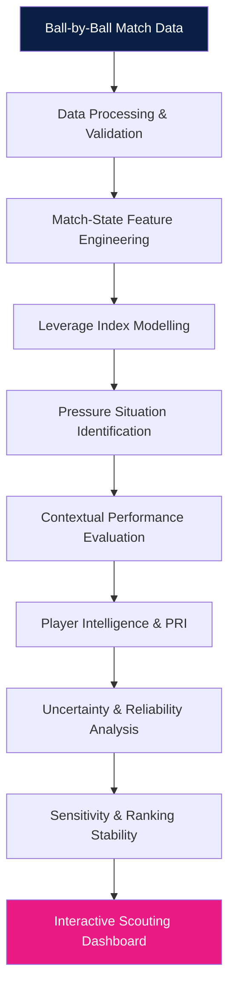

<div align="center">

# PLAYBOOK 27
### THE SCIENCE BEHIND THE SELECTION

**A pressure-aware cricket analytics and player intelligence platform.**

Transforming ball-by-ball match data into contextual performance insights, uncertainty-aware player evaluations, and explainable scouting intelligence.

<br>

[](https://playbook-27.onrender.com/)
[](https://github.com/yogitha-singh/PLAYBOOK-27)

<br>

`CRICKET ANALYTICS` · `MACHINE LEARNING` · `PREDICTIVE MODELLING` · `PLAYER SCOUTING`

<br>

---

### NOT JUST WHO SCORES MORE. WHO PERFORMS WHEN IT MATTERS.

</div>

## ◈ Explore the Platform

<div align="center">

### [↗ OPEN THE LIVE PLAYBOOK 27 DASHBOARD](https://playbook-27.onrender.com/)

*Explore player intelligence, pressure analysis, rankings, model insights, and performance comparisons.*

</div>

> **Deployment note:** The dashboard is hosted on Render's free tier. If the service has been inactive, its first request may take a little longer while it wakes up.

---

## 01 — The Project

Cricket performance is often evaluated through conventional statistics such as runs, wickets, averages, and strike rates.

However, these numbers do not always explain the context in which a performance occurred.

A run scored in a low-pressure situation is not necessarily equivalent to a run scored during a difficult chase. Similarly, a wicket taken when the match is already under control may not carry the same strategic significance as one taken during a critical phase.

**PLAYBOOK 27** explores this problem through a context-aware analytical framework.

Developed for **Rajasthan Royals SupeRR Selector — Season 2**, the platform evaluates batter and bowler performances under pressure using match-state modelling, contextual expectations, statistical reliability, and uncertainty-aware ranking methods.

The objective is not simply to produce another leaderboard.

It is to investigate:

- How does a player perform when match pressure increases?
- Does their performance exceed what would normally be expected in that situation?
- How reliable is the observed performance?
- Do player rankings remain stable under different analytical assumptions?
- How much confidence should be placed in a player's position?

The platform brings these questions together through an interactive scouting dashboard.

---

## 02 — What the Platform Offers

| Module | What it explores |
|---|---|
| **Command Centre** | Overview of the platform's key analytical findings and player intelligence. |
| **Batter Intelligence** | Contextual batter performance and pressure-specific evaluation. |
| **Bowler Intelligence** | Bowler performance across pressure situations and match phases. |
| **Pressure Explorer** | Distribution and characteristics of pressure across match situations. |
| **Player Comparison** | Side-by-side comparison of player performance indicators. |
| **Reliability Leaderboard** | Player evaluation incorporating statistical reliability. |
| **Ranking Stability** | Sensitivity of player rankings to analytical assumptions. |
| **Data & Model Status** | Dataset and modelling status information. |
| **Model Insights** | Predictive model performance and analytical findings. |
| **Methodology** | Explanation of the evaluation framework and its limitations. |

---

## 03 — Dashboard Preview

The dashboard is organised around ten analytical views.

Once the screenshots folder is pushed to the repository, add the corresponding image filenames below.

| Dashboard Module | Preview |
|---|---|
| Command Centre | `screenshots/` |
| Batter Intelligence | `screenshots/` |
| Bowler Intelligence | `screenshots/` |
| Pressure Explorer | `screenshots/` |
| Player Comparison | `screenshots/` |
| Reliability Leaderboard | `screenshots/` |
| Ranking Stability | `screenshots/` |
| Data & Model Status | `screenshots/` |
| Model Insights | `screenshots/` |
| Methodology | `screenshots/` |

> **Screenshot paths:** Replace the entries with the exact PNG filenames in your `screenshots` folder. GitHub image embeds require the actual file path, including its filename.

Example:

```markdown

```

---

## 04 — Analytical Framework

PLAYBOOK 27 follows a multi-stage analytical workflow.



### Stage 1 — Data Processing

Match-level and delivery-level information is processed to create structured analytical inputs.

The pipeline prepares the data for match-state analysis, feature engineering, model training, and player evaluation.

### Stage 2 — Match-State Modelling

Match situations are represented using contextual information such as:

- Innings and match phase
- Score and wickets
- Overs and deliveries remaining
- Required run rate
- Chase situation
- Other relevant match-state variables

These variables help distinguish between situations with different levels of strategic difficulty.

### Stage 3 — Pressure Identification

Pressure is defined using a model-based **Leverage Index**.

Rather than treating pressure as a subjective label, the framework identifies high-leverage situations using the distribution of leverage within an innings.

The analytical framework uses:

- **High pressure:** 80th–95th leverage percentile.
- **Critical pressure:** Top 5% of leverage situations.
- **Pressure deliveries:** High and Critical categories.

This allows performance to be evaluated in relation to the difficulty of the match situation.

### Stage 4 — Contextual Performance Evaluation

A player's contribution is examined relative to the expected performance of an average player facing a comparable situation.

This is important because raw outcomes alone do not account for the context in which they occurred.

The framework therefore focuses on performance relative to a contextual expectation rather than treating every delivery as equivalent.

### Stage 5 — Player Reliability

Observed performance can be misleading when it is based on a limited number of opportunities.

PLAYBOOK 27 incorporates empirical-Bayes shrinkage to account for differences in sample size and statistical reliability.

This helps reduce the influence of unusually extreme results from limited observations.

### Stage 6 — Uncertainty and Ranking Stability

A ranking is an estimate, not an absolute truth.

The platform examines uncertainty and sensitivity to understand whether a player's position is robust or dependent on particular assumptions.

This includes:

- Posterior uncertainty intervals
- Reliability-adjusted player evaluation
- Split-half persistence analysis
- Sensitivity analysis
- Ranking overlap and stability

---

## 05 — The Player Reliability Index

The **Player Reliability Index (PRI)** is designed to support more cautious player evaluation.

Instead of rewarding only high observed performance, the framework considers how much confidence should be placed in the evidence behind that performance.

The methodology incorporates:

- Contextual performance level
- Empirical-Bayes shrinkage
- Statistical uncertainty
- Reliability-adjusted evaluation

The reported PRI uses a conservative lower-bound approach:

\[
PRI = \mu_{posterior} - 1.28 \times \sigma_{posterior}
\]

Where:

- \(\mu_{posterior}\) represents the posterior mean.
- \(\sigma_{posterior}\) represents the posterior standard deviation.

This provides a risk-adjusted estimate rather than relying exclusively on the observed average.

The intention is to distinguish players with consistently supported performance from those whose apparent results may be more uncertain.

---

## 06 — Model Validation

Model performance is evaluated using chronological validation rather than relying only on random train-test splits.

The validation design follows:

| Dataset period | Purpose |
|---|---|
| Before 2025 | Training |
| 2025 | Validation |
| 2026 | Testing |

This helps evaluate whether the models can generalise to later match periods.

### Predictive Model Results

The following reported results illustrate the different modelling tasks.

| Model | Evaluation Metric | Result |
|---|---|---:|
| Chase Win Probability | ROC-AUC | 0.918 |
| Chase Win Probability | Brier Score | 0.123 |
| Chase Win Probability | Log Loss | 0.378 |
| First-Innings Model | ROC-AUC | 0.684 |
| First-Innings Model | Log Loss | 0.671 |
| 9-Class Outcome Model | MAE | 1.381 |
| Flat Baseline | MAE | 1.438 |
| Wicket Prediction | ROC-AUC | 0.587 |

Predictive performance and player-ranking reliability are different questions. A model that predicts match outcomes reasonably well does not automatically establish that pressure-specific player rankings are stable.

For this reason, PLAYBOOK 27 evaluates both predictive performance and the reliability of the resulting player assessments.

---

## 07 — Reliability Is Not the Same as Rank

One of the central findings of this project is that pressure-specific performance has limited persistence across different samples of matches.

The reported split-half persistence is approximately:

| Player Category | Split-Half Persistence |
|---|---:|
| Batters | 0.29 |
| Bowlers | 0.24 |

The rankings should therefore be interpreted as evidence with uncertainty, not as a definitive ordering of player ability.

The analysis also examines:

- Whether players retain their positions under alternative assumptions.
- Whether uncertainty intervals overlap.
- How often players remain within the top group.
- Whether the observed performance is supported by sufficient evidence.

**A player ranked higher is not automatically a player whose superiority has been established with certainty.**

This distinction is fundamental to the platform's methodology.

---

## 08 — Technology Stack

The project combines data analysis, machine learning, backend development, and frontend visualisation.

| Layer | Technologies |
|---|---|
| Programming Language | Python |
| Data Processing | Pandas, NumPy |
| Machine Learning | Scikit-learn |
| Backend | Flask |
| Database | SQLite |
| Frontend | HTML5, CSS3, JavaScript |
| Visualisation | SVG-based charts and interactive dashboard components |
| Containerisation | Docker, Docker Compose |
| Version Control | Git, GitHub |
| Deployment | Render |

---

## 09 — Repository Structure

```text
PLAYBOOK-27/
│
├── .github/
│   └── workflows/
│
├── backend/
│   ├── data/
│   │   └── processed/
│   ├── ...
│   └── ...
│
├── data/
│   └── processed/
│
├── docs/
│   ├── METHODOLOGY.md
│   ├── FRONTEND.md
│   ├── MODEL_CARD.md
│   ├── DATA_DICTIONARY.md
│   ├── ARCHITECTURE.md
│   ├── API_DOCUMENTATION.md
│   ├── DEPLOYMENT.md
│   └── VERIFICATION.md
│
├── frontend/
│
├── models/
│
├── scripts/
│
├── .gitignore
├── docker-compose.yml
├── README.md
└── __init__.py
```

*The tree is a high-level overview; individual implementation files are omitted for readability.*

---

## 10 — Documentation

The repository includes supporting documentation for the platform's analytical and technical components.

| Document | Description |
|---|---|
| [Methodology](docs/METHODOLOGY.md) | Analytical methodology and player evaluation framework. |
| [Frontend](docs/FRONTEND.md) | Dashboard structure and frontend implementation. |
| [Model Card](docs/MODEL_CARD.md) | Model information, evaluation, and limitations. |
| [Data Dictionary](docs/DATA_DICTIONARY.md) | Description of analytical data fields. |
| [Architecture](docs/ARCHITECTURE.md) | System architecture and component organisation. |
| [API Documentation](docs/API_DOCUMENTATION.md) | Backend API documentation. |
| [Deployment](docs/DEPLOYMENT.md) | Deployment information. |
| [Verification](docs/VERIFICATION.md) | Verification and testing information. |

---

## 11 — Running Locally

To explore or run the project locally:

### 1. Clone the repository

```bash
git clone https://github.com/yogitha-singh/PLAYBOOK-27.git
```

```bash
cd PLAYBOOK-27
```

### 2. Explore the project

Review the backend, frontend, model, and documentation directories to understand the application structure.

### 3. Review the setup instructions

Refer to the repository's deployment and architecture documentation for the current environment configuration and execution instructions.

> Local execution commands depend on the configured backend entry point and environment. Follow the repository documentation rather than assuming a default Flask startup command.

---

## 12 — Responsible Data Use

The project is designed around analytical evaluation and derived outputs.

A few principles guide its use:

- Raw competition data should not be redistributed without the appropriate permission.
- Model outputs should be interpreted in the context of their validation results.
- Rankings should not be treated as definitive measures of player ability.
- Uncertainty and sample-size limitations should remain visible.
- Predictive associations should not automatically be interpreted as causal relationships.

The purpose of the platform is to support informed analysis, not to replace expert scouting judgement.

---

## 13 — Known Limitations

PLAYBOOK 27 is an analytical framework, not a claim of perfect player evaluation.

Its limitations include:

1. **Limited persistence:** Pressure-specific performance may not remain consistent across different samples of matches.
2. **Sample-size effects:** Players have different numbers of opportunities in pressure situations.
3. **Model uncertainty:** Predictive models are subject to estimation error and distribution shifts.
4. **Context dependence:** Match situations are complex and cannot always be fully represented by available features.
5. **Ranking sensitivity:** Alternative assumptions can change player ordering.
6. **Interpretation risk:** A high ranking should not be interpreted as proof of future performance.

These limitations are part of the analytical results, not details to be hidden.

---

## 14 — Future Scope

Potential extensions of the platform include:

- More extensive out-of-sample evaluation.
- Additional contextual player-performance indicators.
- Improved calibration and uncertainty estimation.
- Further analysis of player-role differences.
- More robust ranking stability experiments.
- Expanded scouting visualisations.
- Additional match-state and tactical analysis.

---

## 15 — Acknowledgements

Developed as an independent cricket analytics project for **Rajasthan Royals SupeRR Selector — Season 2**.

The project brings together statistical modelling, machine learning, data engineering, and interactive visualisation to explore a simple but important question:

<div align="center">

### WHO PERFORMS WHEN THE GAME IS ON THE LINE?

**PLAYBOOK 27**

*Evidence over assumptions. Context over raw numbers. Reliability over certainty.*

<br>

[**EXPLORE THE LIVE DASHBOARD ↗**](https://playbook-27.onrender.com/)

</div>

---

<div align="center">

Made with analytical curiosity and a love for the game.

**PLAYBOOK 27 · 2026**

</div>
